<p align="center">
  
</p>

<div align="center">

```
   █████╗ ███████╗ ██████╗ ██╗███████╗    ██╗   ██╗ █████╗ ██╗   ██╗██╗  ████████╗
  ██╔══██╗██╔════╝██╔════╝ ██║██╔════╝    ██║   ██║██╔══██╗██║   ██║██║  ╚══██╔══╝
  ███████║█████╗  ██║  ███╗██║███████╗    ██║   ██║███████║██║   ██║██║     ██║   
  ██╔══██║██╔══╝  ██║   ██║██║╚════██║    ╚██╗ ██╔╝██╔══██║██║   ██║██║     ██║   
  ██║  ██║███████╗╚██████╔╝██║███████║     ╚████╔╝ ██║  ██║╚██████╔╝███████╗██║   
  ╚═╝  ╚═╝╚══════╝ ╚═════╝ ╚═╝╚══════╝      ╚═══╝  ╚═╝  ╚═╝ ╚═════╝ ╚══════╝╚═╝   
```

# 🛡️ AegisVault — Donanıma Kilitli, Anti-RAT ve RAM Tabanlı Sıfır-Güven Dosya Kasası
### *Bilgisayarınız Canlı Olarak Hacklense Dahi Dosyalarınızın Çalınmasını Matematiksel Olarak İmkansız Kılan Siber Savunma Kalesi*

<p align="center">
  <a href="#-neden-çalınması-matematiksel-olarak-imkansız"></a>
  <a href="#-4-katmanlı-kriptografik-zırh"></a>
  <a href="#-4-katmanlı-kriptografik-zırh"></a>
  <a href="#-adli-bilişim-seviyesinde-imha-anti-forensics"></a>
  <a href="#-adım-adım-kurulum-rehberi"></a>
  <a href="LICENSE"></a>
</p>

---

> [!IMPORTANT]
> **TEMEL TEHDİT MODELİ:** Bilgisayarınıza tam yetkili (SYSTEM / Admin) bir RAT, infostealer veya fidye yazılımı (ransomware) sızmış olsa bile; saldırgan kasa klasörünüzdeki dosyaları kendi bilgisayarına kopyaladığında **asla kıramaz**, bilgisayarınızı canlı olarak izlese bile dosyaların açık halini diskten veya sistem dosyalarından çekemez.

</div>

---

## 📌 İÇİNDEKİLER
1. [🌟 Neden Çalınması Matematiksel Olarak İmkansız? (4-Kilit Kuralı)](#-neden-çalınması-matematiksel-olarak-imkansız)
2. [⚔️ Hacker Senaryoları Karşılaştırma Matrisi](#-hacker-senaryoları-karşılaştırma-matrisi)
3. [🔬 4-Katmanlı Kriptografik Zırh & Nasıl Çalışır?](#-4-katmanlı-kriptografik-zırh)
4. [📁 Dahili RAM Klasör & Dosya Gezgini (Zero-Disk Footprint)](#-dahili-ram-klasör--dosya-gezgini)
5. [🏢 Şirket ve Kurumsal Veri Güvenliği Kılavuzu](#-şirket-ve-kurumsal-veri-güvenliği-kılavuzu)
6. [🚀 Adım Adım Kurulum Rehberi (Github'dan İndirip Çalıştırma)](#-adım-adım-kurulum-rehberi)
7. [💡 Günlük Kullanım Rehberi (Adım Adım)](#-günlük-kullanım-rehberi)
8. [🗂️ Modüler Proje Dosya Mimarisi](#-modüler-proje-dosya-mimarisi)
9. [❓ Sıkça Sorulan Sorular (SSS)](#-sıkça-sorulan-sorular-sss)

---

## 🌟 Neden Çalınması Matematiksel Olarak İmkansız?

Klasik şifreleme programları (BitLocker, 7-Zip, VeraCrypt vb.) dosya şifrelerken sadece bir parola ister. Parolayı bilen ya da bilgisayarı ele geçiren herkes dosyayı başka bir bilgisayarda da açabilir.

**AegisVault bu mantığı çöpe atar.** Bir dosyanın açılabilmesi için **4 AYRI FAKTÖRÜN AYNI ANDA** mevcut olması şarttır:

```
┌────────────────────────────────────────────────────────────────────────┐
│                   BİR DOSYAYI AÇMAK İÇİN GEREKENLER                    │
├────────────────────────────────────────────────────────────────────────┤
│  1. Şifreli Kasa Dosyası (.aegis)                                      │
│               +                                                        │
│  2. Fiziksel Harici USB Bellek (aegis_key.vault)                       │
│               +                                                        │
│  3. Kullanıcının Bildiği Ana Güvenlik Parolası (Argon2id)              │
│               +                                                        │
│  4. BİREBİR AYNI BİLGİSAYARIN DONANIMI (Anakart UUID + CPU ID)        │
└────────────────────────────────────────────────────────────────────────┘
```

> [!CAUTION]
> **DÜNYANIN EN İYİ HACKER'I BİLE OLSA:**
> Saldırgan `.aegis` dosyanızı çalsa, USB belleğinizi çalsa, hatta parolanızı öğrense bile; kendi evindeki bilgisayarına geçtiğinde dosyayı **AÇAMAZ**. Çünkü dosya şifrelenirken anakartınızın ve işlemcinizin donanım imzası şifrenin içine **mühür (AAD)** olarak işlenmiştir. Farklı bir anakartta şifre çözme algoritması doğrudan çöker (`InvalidTag`)!

---

## ⚔️ Hacker Senaryoları Karşılaştırma Matrisi

| Saldırı Senaryosu | Klasik Kasa / Arşiv Programları | AegisVault Savunması |
| :--- | :--- | :--- |
| **Hacker Bilgisayara Sızdı (RAT/C2)** | Bilgisayardaki açık temp dosyalarını ve parola hash'lerini çalar. | **İMKANSIZ.** Bilgisayarda yalnızca Public Key vardır. Açma anahtarı fiziksel olarak USB'dedir. |
| **Kasa Dosyalarını İnternete Çaldı** | Dosyayı indirip GPU çiftliklerinde brute-force dener. | **İMKANSIZ.** Dosya bilgisayarın anakartına kilitlidir; başka PC'de matematiksel olarak açılamaz. |
| **USB Belleği ve Dosyaları Birlikte Çaldı** | USB'deki anahtarı doğrudan kullanır. | **İMKANSIZ.** USB'deki anahtar 64 MB RAM maliyetli **Argon2id** ile zırhlıdır; parola olmadan okunamaz. |
| **Dosyaları, USB'yi Çaldı + Parolayı da Öğrendi!** | Kendi laptopunda programı açıp dosyaları deşifre eder. | **İMKANSIZ.** Donanım Mührü (Hardware AAD) uyuşmadığı için algoritma `InvalidTag` fırlatır ve açılmaz! |
| **Canlı Ekran İzleme (Spyware/OBS/Discord)** | Kullanıcı dosyayı açtığında ekran görüntüsüyle çalar. | **KORUMALI.** `SetWindowDisplayAffinity` API'si ile ekran yakalama araçlarında pencere simsiyah render edilir. |
| **Hafıza Dökümü (Memory Dump / Pagefile)** | Windows RAM takası (`pagefile.sys`) ile diskten veriyi çeker. | **İMKANSIZ.** Windows `VirtualLock` API'si ile tampon fiziksel RAM'e kilitlenir; takaslama engellenir. |
| **Fiziksel Baskın / Tehlike Anı** | Açık pencereleri kapatmak vakit alır. | **0.5 SANİYE.** USB'yi çekin veya `Ctrl+Alt+Shift+X` panik tuşuna basın; tüm RAM `0` ile ezilir ve kapanır. |

---

## 🔬 4-Katmanlı Kriptografik Zırh

AegisVault dosya güvenliğini 4 bağımsız kriptografik zırhla sağlar:

```mermaid
flowchart TD
    subgraph KILITLEME ["🔒 1. KİLİTLEME AKIŞI (Arka Planda / Parolasız)"]
        A["Orijinal Dosya / Klasör"] --> B["RAM'de Tek Kullanımlık Rastgele 256-bit AES Anahtarı Üret"]
        B --> C["Bilgisayardaki RSA-4096 Public Key ile AES Anahtarını Mühürle"]
        D["Anakart UUID + MachineGuid + CPU ID"] --> E["SHA-256 Donanım Özeti (Hardware AAD)"]
        B --> F["AES-256-GCM Streaming Chunk Şifreleme (64 KB Parçalar)"]
        E --> F
        C --> G[".aegis Kasa Dosyası"]
        F --> G
        A --> H["🔥 Anti-Forensics Shredder (0x00, 0xFF, urandom, fsync, MFT Scrub)"]
        H --> I["Orijinal Açık Dosya Diskten Tamamen Yok Edildi"]
    end

    subgraph COZME ["🔓 2. RAM'DE AÇMA AKIŞI (Sıfır Disk Ayak İzi)"]
        J[".aegis Kasa Dosyası"] --> K{"Harici USB Bellek Takılı mı?"}
        K -- "Hayır" --> L["ERİŞİM REDDEDİLDİ"]
        K -- "Evet" --> M["Argon2id (64MB) ile USB'deki Private Key'i Çöz"]
        M --> N["RSA-4096 Private Key ile Dosyanın AES Anahtarını Çöz"]
        N --> O{"Donanım İmzası Bu Bilgisayarla Uyuşuyor mu?"}
        O -- "Farklı PC / Çalıntı" --> P["🚨 InvalidTag: DONANIM UYUŞMAZLIĞI (Açılmaz!)"]
        O -- "Doğru PC" --> Q["Windows VirtualLock ile Kilitli RAM Tamponuna Aç"]
        Q --> R["Anti-Capture Korumalı Dahili RAM Önizleyici & Klasör Gezgini"]
    end

    subgraph PANIK ["🚨 3. DEAD-MAN'S SWITCH"]
        S["500ms USB Polling / Panik Tuşu: Ctrl+Alt+Shift+X"] --> T["ctypes.memset: RAM'deki Tüm Verileri 0'la Sıfırla"]
        T --> U["Önizleme Pencerelerini Anında Kapat"]
    end
```



### 1. Tek Yönlü Hibrit Kilitleme (RSA-4096 + AES-256-GCM)
* Şifreleme için bilgisayarda yalnızca **Public Key (`public.pem`)** tutulur.
* Dosya boyutu ne olursa olsun (50 GB veri tabanı veya 4K video bile olsa), dosya **64 KB'lık streaming chunk'lar** halinde AES-256-GCM ile şifrelenir; RAM şişmesi yaşanmaz.
* Üretilen geçici AES anahtarı RSA-4096 Public Key ile mühürlenip dosya başlığına eklenir ve ham AES anahtarı bellekten anında silinir.

### 2. Donanım Mührü (Hardware-Bound AAD)
* Windows `MachineGuid`, anakart `UUID` ve işlemci `ProcessorId` değerlerinin SHA-256 özeti alınır.
* Bu 32-baytlık imza, AES-256-GCM'in AAD (Additional Authenticated Data) katmanına dahil edilir.
* Dosya başka bir anakartta çözülmeye çalışıldığında GCM kimlik doğrulama etiketi geçersiz sayılır ve dosya açılamaz.

### 3. Argon2id Korumalı Harici USB Anahtarı
* Dosyaları açabilecek tek anahtar olan **Private Key**, bilgisayarda asla saklanmaz.
* Sadece harici USB belleğinizde, **Argon2id KDF** algoritmasıyla 64 MB bellek maliyeti (`memory_cost=65536`), 3 iterasyon ve 4 paralel hat üzerinden şifrelenmiş olarak tutulur.

### 4. Adli Bilişim Seviyesinde İmha (DoD 5220.22-M Anti-Forensics)
* Şifrelenen orijinal açık dosya standart silme ile silinmez:
  1. Dosyanın her sektörünün üzerine `0x00` (sıfır baytları) yazılır.
  2. İkinci turda `0xFF` (bir baytları) yazılır.
  3. Üçüncü turda kriptografik rastgele gürültü (`os.urandom`) yazılır.
  4. Her turda `os.fsync` çağrılarak SSD/HDD yazma önbellekleri donanıma yazmaya zorlanır.
  5. Dosya boyutu sıfırlanır, zaman damgaları sıfırlanır ve NTFS MFT kayıtları dosya adı 3 kez rastgele UUID'lerle değiştirilerek karartılır.

---

## 📁 Dahili RAM Klasör & Dosya Gezgini

AegisVault bir dosyayı veya klasörü açtığında **sabit diske ASLA dokunmaz.** Veri doğrudan Windows `VirtualLock` ile kilitlenmiş RAM tamponuna çözülür.

<div align="center">
  <h3>🖥️ İki Panelli İnteraktif RAM Dosya Yöneticisi</h3>
</div>

* **Klasör Kilitlediğinizde:** Klasörün içindeki tüm dosyalar (`hello.txt`, görseller, dökümanlar) RAM'de açılır.
* **Sol Panelde:** Klasörün içindeki tüm dosyalar ağaç yapısında listelenir.
* **Sağ Panelde:** Tıkladığınız dosya anında RAM'den okunur; metinler kod editöründe, resimler görsel önizleyicide, PDF'ler dahili PDF okuyucuda görüntülenir.
* **💾 "Diske Çıkar (Kurtar)" Butonları:** Dilediğiniz zaman tek bir dosyayı veya tüm klasörü şifresiz orijinal haliyle diske (Masaüstü, İndirilenler vb.) geri çıkarabilirsiniz.

---

## 🏢 Şirket ve Kurumsal Veri Güvenliği Kılavuzu

Şirketinizin mali tabloları, patentleri, müşteri veritabanları (KVKK/GDPR), kaynak kodları ve ticari sırları için önerilen kurumsal konuşlandırma:

1. **İş İstasyonlarına Kurulum:** Şirket bilgisayarlarına AegisVault kurulur ve USB kurulum sihirbazı ile anahtar oluşturulur. Bilgisayarda yalnızca personelin dosya kilitleyebileceği Public Key kalır.
2. **Otomatik Kasa Klasörü:** Personel mesai boyunca ürettiği hassas raporları masaüstündeki `AegisVault_DropBox` klasörüne atar. Dosyalar saniyeler içinde şifrelenir ve açık kopyaları diskten adli seviyede yok edilir.
3. **Fiziksel USB Koruması:** Açma yetkisine sahip USB bellek, şirket yöneticisinin kasasında veya yetkili personelin şahsi anahtarlığında fiziksel olarak internetten izole (Air-Gapped) saklanır.
4. **Fidye Yazılımı (Ransomware) ve Hırsızlık Güvencesi:** Bilgisayarlar çalınsa, ofis basılsa veya şirket ağı ele geçirilse dahi; saldırganın eline geçen tüm `.aegis` dosyaları matematiksel olarak açılamaz anlamsız veri bloklarıdır.

---

## 🚀 Adım Adım Kurulum Rehberi

### 1. Sistem Gereksinimleri
* **İşletim Sistemi:** Windows 10 veya Windows 11 (64-bit)
* **Python Sürümü:** Python 3.10, 3.11, 3.12, 3.13 veya 3.14+
* **Fiziksel Donanım:** 1 adet harici USB Flash Bellek

### 2. Depoyu İndirin ve Bağımlılıkları Yükleyin
PowerShell veya Komut Satırı'nı açın:
```powershell
# Depoyu klonlayın veya indirin
git clone https://github.com/kullanici-adiniz/aegis-vault.git
cd aegis-vault

# Gerekli kütüphaneleri yükleyin
pip install -r requirements.txt
```

### 3. Windows Sağ Tık Menüsünü Etkinleştirin
Windows Gezgini'nde herhangi bir dosyaya veya klasöre sağ tıkladığınızda *"AegisVault ile Kilitle ve İmha Et 🛡️"* seçeneğinin çıkması için:
```powershell
python aegis_vault/setup_windows.py --install
```
*(Yönetici yetkisi gerektirmez; `HKEY_CURRENT_USER` altına güvenle kurulur.)*

---

## 💡 Günlük Kullanım Rehberi

### Adım 1: USB Anahtarınızı Oluşturun
1. Bilgisayarınıza bir USB bellek takın.
2. `python -m aegis_vault.main` komutuyla veya masaüstündeki başlatıcıyla AegisVault'u açın.
3. Sol menüden **"🔑 USB Anahtar Kurulumu"** sekmesine gelin.
4. USB sürücünüzü seçin ve en az 8 karakterli güçlü bir Ana Parola belirleyin.
5. **"RSA-4096 Anahtarlarını Üret ve USB'ye Mühürle"** butonuna basın.

### Adım 2: Dosyaları Kilitleme
* **Otomatik Yöntem:** Masaüstünüzdeki `AegisVault_DropBox` klasörüne istediğiniz dosya veya klasörü sürükleyip bırakın. 1 saniyede `.aegis` formatına dönüşür, orijinal açık kopya adli seviyede imha edilir.
* **Sağ Tık Yöntemi:** Bilgisayardaki herhangi bir dosyaya sağ tıklayıp **"AegisVault ile Kilitle ve İmha Et 🛡️"** seçeneğini seçin.
* **Manuel Yöntem:** Uygulamadaki **"🔒 Dosya Kilitle & İmha Et"** sekmesinden dosya/klasör seçip kilitleyin.

### Adım 3: Dosyaları RAM'de Güvenli Görüntüleme
1. USB belleğinizi bilgisayara takın.
2. Uygulamada **"🔓 RAM'de Güvenli Aç"** sekmesinden `.aegis` dosyanızı seçip master parolanızı girin.
3. **"👁️ RAM'de Aç ve Güvenli Görüntüle"** butonuna basın.
4. Dosyanız veya klasörünüz diske tek bir bayt bile yazılmadan RAM'de açılır.

### Adım 4: Dead-Man's Switch (USB Çekme Testi)
* Ekranda kilitli bir dosyanız açıkken USB belleği bilgisayardan fiziksel olarak çekin.
* **0.5 saniye içinde** tüm pencereler anında kapanacak ve RAM'deki veriler `0` baytı ile sıfırlanacaktır!
* Alternatif olarak acil durumda klavyeden **`Ctrl + Alt + Shift + X`** tuşlarına bastığınız an panik kilidi devreye girer.

---

## 🗂️ Modüler Proje Dosya Mimarisi

```
aegis_vault/
│
├── aegis_vault/
│   ├── __init__.py                  # Paket başlangıcı (v1.0.0)
│   ├── main.py                      # Uygulama başlatıcı, System Tray & CLI yöneticisi
│   ├── setup_windows.py             # Windows Registry sağ tık entegrasyon aracı
│   │
│   ├── core/                        # Kriptografi ve İmha Çekirdeği
│   │   ├── __init__.py
│   │   ├── crypto_engine.py         # RSA-4096 + AES-256-GCM + Hardware AAD + Argon2id + VirtualLock
│   │   └── shredder.py              # DoD 5220.22-M 3-Pass güvenli imha & MFT temizleyici
│   │
│   ├── services/                    # Arka Plan Servisleri
│   │   ├── __init__.py
│   │   ├── watcher.py               # Watchdog 7/24 otomatik kasa klasörü izleme
│   │   └── usb_guard.py             # 500ms Dead-Man's Switch ve Panik Hotkey dinleyici
│   │
│   └── ui/                          # Grafik Arayüz ve RAM Önizleme
│       ├── __init__.py
│       ├── app_window.py            # CustomTkinter ana kontrol paneli ve USB sihirbazı
│       └── ram_viewer.py            # Disksiz RAM Klasör Gezgini & Önizleyici (Metin, Görsel, PDF)
│
├── tests/                           # Kapsamlı Otomasyonel Test Paketi
│   └── test_crypto_shredder.py      # Kriptografik doğrulama ve imha testleri
│
├── requirements.txt                 # Bağımlılık listesi
└── README.md                        # Detaylı mimari ve kullanım dokümantasyonu
```

---

## ❓ Sıkça Sorulan Sorular (SSS)

#### S: Hacker bilgisayarıma tam yetkili (SYSTEM/Admin) olarak bağlandıysa dosyaları açabilir mi?
**C: HAYIR, AÇAMAZ.** Bilgisayarda yalnızca şifreleme yapabilen Public Key (`public.pem`) bulunur. Şifre çözme anahtarı olan Private Key bilgisayarınızda fiziksel olarak yoktur; cebinizdeki USB bellektedir. Hacker tüm hard diskinizi kopyalasa dahi matematiksel olarak dosyalarınızı açamaz.

#### S: Hacker hem `.aegis` dosyalarımı hem de USB belleğimi çalarsa dosyalarımı açabilir mi?
**C: HAYIR, AÇAMAZ.** AegisVault "Donanım Mührü" (Hardware-Bound AAD) kullanır. Şifreleme sırasında o bilgisayarın anakart UUID'si, CPU ID'si ve Windows MachineGuid'i şifreleme algoritmasının AAD katmanına kazınır. Başka bir bilgisayara takıldığında donanım imzası uyuşmayacağı için şifre çözme işlemi `InvalidTag` fırlatarak çöker. Ayrıca USB bellekteki anahtar da Argon2id ile şifrelidir; parolanızı bilmeden USB anahtarı da okunamaz.

#### S: USB belleğimi kaybedersem ne olur?
**C: Güvenlik tavsiyesi:** USB kurulumunu yaptıktan sonra `aegis_key.vault` dosyasını ikinci bir yedek USB belleğe kopyalayıp güvenli bir kasada (örneğin ev veya ofis kasasında) saklayın.

#### S: Büyük video veya arşiv dosyalarını (10 GB+) şifreleyebilir miyim?
**C: EVET.** AegisVault streaming chunk mimarisine sahiptir. Dosyayı 64 KB'lık akış blokları halinde şifreler. 10 GB veya 50 GB boyutundaki devasa dosyalar bile bilgisayarın RAM'ini şişirmeden yüksek hızla kilitlenir.

---

<p align="center">
  
</p>

<p align="center">
  <b>AegisVault</b> — Geleceğin Sıfır-Güven Dosya Kasası.<br>
  <i>"Veriniz, yalnızca siz izin verdiğiniz sürece ve yalnızca sizin donanımınızda var olur."</i>
</p>
